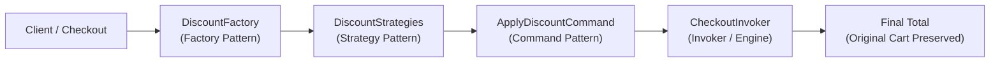

# Dynamic Discount Engine (Strict TDD & GoF Patterns)

[](https://www.typescriptlang.org/)
[](https://jestjs.io/)
[]()
[]()

A robust, extensible, and strictly test-driven E-commerce Dynamic Discount Engine built with **TypeScript** and **Jest**. This engine demonstrates how classic **Gang of Four (GoF)** design patterns harmonize to evaluate, create, and sequence business discount rules without side effects or cart mutations.

---

## 🏗 Architecture & Design Patterns

The engine combines three complementary Gang of Four design patterns:



### 1. The Strategy Pattern (The Rules)
Each discount algorithm is encapsulated behind a shared [`DiscountStrategy`](file:///home/morg3an/strict-tdd-rule-engine/src/strategies/DiscountStrategy.ts) interface (`apply(cartTotal: number): number`).

- [`VipCustomerStrategy`](file:///home/morg3an/strict-tdd-rule-engine/src/strategies/VipCustomerStrategy.ts): Applies a flat 10% discount.
- [`SeasonalSaleStrategy`](file:///home/morg3an/strict-tdd-rule-engine/src/strategies/SeasonalSaleStrategy.ts): Applies a 20% seasonal markdown.
- [`BulkOrderStrategy`](file:///home/morg3an/strict-tdd-rule-engine/src/strategies/BulkOrderStrategy.ts): Conditionally applies a 15% discount when cart totals equal or exceed \$200.

### 2. The Factory Pattern (The Rule Creator)
[`DiscountFactory`](file:///home/morg3an/strict-tdd-rule-engine/src/factories/DiscountFactory.ts) decouples strategy instantiation from execution. It accepts string identifiers (`"VIP"`, `"SEASONAL"`, `"BULK"`) or customer profiles (`{ isVip: true }`), complete with strict error handling for unknown discount types.

### 3. The Command Pattern (The Engine)
- [`ApplyDiscountCommand`](file:///home/morg3an/strict-tdd-rule-engine/src/commands/ApplyDiscountCommand.ts): Encapsulates the cart reference, target discount strategy, and execution logic.
- [`CheckoutInvoker`](file:///home/morg3an/strict-tdd-rule-engine/src/invoker/CheckoutInvoker.ts): Queues multiple discount commands, pipes intermediate totals sequentially, and guarantees that the original cart total is **never mutated directly**.

---

## 🧪 Strict TDD Commit Protocol

Developed strictly under the atomic Red-Green-Refactor loop:

1. 🔴 **Red**: Write the failing test and run Jest to verify the failure.
2. 🟢 **Green**: Implement the minimum viable code to make the test pass.
3. 🔵 **Refactor**: Clean types, eliminate duplication, and extract configuration constants while keeping tests green.

---

## 📂 Project Structure

```text
src/
├── commands/
│   ├── ApplyDiscountCommand.test.ts
│   ├── ApplyDiscountCommand.ts
│   └── Command.ts
├── factories/
│   ├── DiscountFactory.test.ts
│   └── DiscountFactory.ts
├── invoker/
│   ├── CheckoutInvoker.test.ts
│   └── CheckoutInvoker.ts
├── models/
│   └── Cart.ts
├── strategies/
│   ├── BulkOrderStrategy.test.ts
│   ├── BulkOrderStrategy.ts
│   ├── DiscountStrategy.ts
│   ├── SeasonalSaleStrategy.test.ts
│   ├── SeasonalSaleStrategy.ts
│   ├── VipCustomerStrategy.test.ts
│   └── VipCustomerStrategy.ts
└── index.ts
```

---

## 🚀 Quick Start

### Installation

```bash
npm install
```

### Running Tests

```bash
npm test
```

### Type Checking

```bash
npx tsc --noEmit
```

---

## 💻 Example Usage

```typescript
import {
  Cart,
  DiscountFactory,
  ApplyDiscountCommand,
  CheckoutInvoker,
} from './src';

// 1. Initial Cart (immutability guaranteed)
const cart: Cart = { total: 200 };

// 2. Instantiate Factory & Strategies
const factory = new DiscountFactory();
const bulkStrategy = factory.create('BULK');         // -15% >= 200
const vipStrategy = factory.create({ isVip: true }); // -10%
const seasonalStrategy = factory.create('SEASONAL'); // -20%

// 3. Queue and Execute via Invoker
const checkout = new CheckoutInvoker(cart)
  .addCommand(new ApplyDiscountCommand(cart, bulkStrategy))
  .addCommand(new ApplyDiscountCommand(cart, vipStrategy))
  .addCommand(new ApplyDiscountCommand(cart, seasonalStrategy));

const finalPrice = checkout.process();

console.log(finalPrice); // 122.4
console.log(cart.total); // 200 (original cart remains untouched!)
```
